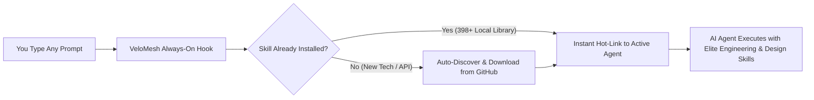

<div align="center">

# ⚡ VeloMesh

### **Install Once in 1 Command. Works Automatically in Every AI Coding Agent.**
**Zero Slash Commands · Zero Config Files · 398+ Skills · Automatic On-The-Fly Capability Discovery**

### 🌐 **[Live Interactive Product Website → ritvikchunamari.github.io/velomesh](https://ritvikchunamari.github.io/velomesh/)**

[](https://ritvikchunamari.github.io/velomesh/)
[](https://opensource.org/licenses/MIT)
[](https://www.python.org/)
[](https://nodejs.org/)
[](https://modelcontextprotocol.io)
[](#what-happens-automatically-under-the-hood)

**Supported AI Agents (Auto-Configured):**  
`Claude Code` · `OpenAI Codex` · `Cursor` · `GitHub Copilot` · `Google Antigravity` · `OpenCode` · `VS Code`

</div>

---

## 🚀 1-Command Installation

Run this single command in your terminal. It automatically downloads **VeloMesh**, provisions **398+ skills**, and auto-configures **all** of your AI coding agents (`Claude Code`, `Cursor`, `Codex`, `GitHub Copilot`, `Antigravity`, `OpenCode`):

### macOS & Linux
```bash
curl -fsSL https://raw.githubusercontent.com/RitvikChunamari/velomesh/main/install.sh | bash
```

### Windows (PowerShell)
```powershell
irm https://raw.githubusercontent.com/RitvikChunamari/velomesh/main/install.ps1 | iex
```

*That’s it. No JSON files to edit. No API keys required. No manual setup.*

---

## ✨ How to Use: Do Nothing. Just Prompt.

Once installed, **you never need to type a command, slash command, or mention VeloMesh again.**

1. **Open any AI coding tool** (Claude Code, Cursor, Codex, GitHub Copilot, Antigravity, or OpenCode) in **any project**.
2. **Type your normal prompt** (e.g., *"Build a SaaS dashboard with Stripe billing"* or *"Fix the race condition in my auth middleware"*).
3. **VeloMesh runs 100% automatically in the background:**
   - **Auto-Activates Relevant Skills:** Automatically selects the best 1–3 engineering, UI/UX, debugging, or TDD skills for your prompt.
   - **Auto-Downloads Missing Capabilities:** If your task needs a specialized framework, API, or MCP server you don't have yet, VeloMesh automatically finds, validates, downloads, and hot-links it on the fly.
   - **Protects Your Context Window:** Uses **Smart Dynamic Linking** so your AI agent stays fast and inside its peak reasoning zone without prompt bloat.

---

## 🧠 What Happens Automatically Under the Hood



### Why Developers Love VeloMesh
| Without VeloMesh | With VeloMesh |
| :--- | :--- |
| Manually copy-pasting `.cursorrules`, `CLAUDE.md`, and `AGENTS.md` into every repo | **Global & automatic** across every project on your machine |
| Typing `/skill` or remembering which workflow command to run | **Zero commands** — triggers automatically on every prompt |
| Installing 300+ skills breaks your AI's context budget | **Smart Dynamic Linking** keeps ~60 core skills active and hot-links the other 330+ on demand |
| Hunting GitHub for MCP servers and editing `mcp.json` by hand | **Automatic MCP wiring** + on-the-fly GitHub skill/MCP provisioning |

---

## 📦 Included Curated Ecosystem (398+ Skills & 86+ Design Systems)

VeloMesh automatically aggregates and maintains skills from the top open-source agentic engineering repositories:
- **[Everything Claude Code (ECC)](https://github.com/affaan-m/everything-claude-code)** — Full 300-skill catalog (TDD, security review, language idioms, DevOps, backend/frontend patterns).
- **[Superpowers](https://github.com/obra/superpowers)** — Brainstorming, test-driven development, systematic debugging, parallel subagent dispatching.
- **[Awesome Design MD](https://github.com/VoltAgent/awesome-design-md)** — 86+ real-world brand design systems (Linear, Stripe, Vercel, Raycast, Apple, Framer).
- **[Awesome Agent Skills](https://github.com/VoltAgent/awesome-agent-skills)** & **[Official MCP Servers](https://github.com/modelcontextprotocol/servers)**.

---

<details>
<summary><b>⚙️ Optional CLI Reference (For Power Users Only)</b></summary>

<br>

You never need to run these commands during normal usage, as VeloMesh operates autonomously. They are provided only if you want to inspect status or customize behavior:

```bash
# Check installed skill count and connected AI agents
velomesh status

# Manually search or pre-install a specific GitHub skill/repo
velomesh install-skill "stripe webhook"

# Re-sync skills across all agent directories
velomesh sync

# Remove VeloMesh managed rules from your agents
velomesh uninstall-rules
```

</details>

---

## 🔒 Security & Privacy

- **Zero External Dependencies:** Built purely on the Python 3.9+ and Node.js 18+ standard libraries.
- **Non-Destructive:** Existing custom skills, MCP servers, and user rules are preserved and backed up automatically before any update.
- **Path-Traversal & Symlink Hardened:** All downloaded repositories are validated before linking.

## 📄 License

Released under the [MIT License](LICENSE). Created by [Ritvik Chunamari](https://github.com/RitvikChunamari).
