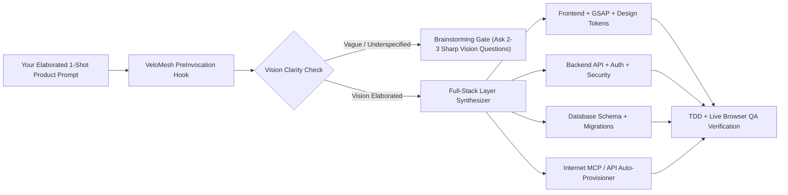

<div align="center">

# ⚡ VeloMesh

### **Build Polished Websites, Full-Stack Products, Backends, Frontends & Databases in One Prompt.**
**Autonomous Internet Capability Engine · Live MCPs, APIs, Agents & 398+ Skills · Zero Slash Commands · Zero Config Files**

### 🌐 **[Live Interactive Product Experience → ritvikchunamari.github.io/velomesh](https://ritvikchunamari.github.io/velomesh/)**

[](https://ritvikchunamari.github.io/velomesh/)
[](https://opensource.org/licenses/MIT)
[](https://www.python.org/)
[](https://nodejs.org/)
[](https://modelcontextprotocol.io)
[](#how-velomesh-orchestrates-the-entire-stack-from-one-prompt)

**Supported AI Agents (Auto-Wired Globally in 1 Command):**  
`Claude Code` · `OpenAI Codex` · `Cursor` · `GitHub Copilot` · `Google Antigravity` · `OpenCode` · `VS Code`

</div>

---

## ⚡ What Is VeloMesh?

VeloMesh is **not** a passive skill pack. It is an **always-on, autonomous Full-Stack & Internet Capability Engine** that sits underneath all of your AI coding agents (`Claude Code`, `Cursor`, `Codex`, `GitHub Copilot`, `Antigravity`, and `OpenCode`).

When you submit a single prompt to build a product, VeloMesh intercepts the task before your agent writes a single line of code and autonomously coordinates **every layer of software creation**:

1. **🎨 Awwwards-Grade Frontend & Interactive Motion:** Automatically routes `frontend-design`, `impeccable`, `emil-design-eng`, `gsap-core`, `gsap-scrolltrigger`, interactive WebGL/Canvas physics, and 86+ reference design systems (`Linear`, `Raycast`, `Stripe`, `Vercel`, `Framer`)—banning flat, generic "AI slop" layouts.
2. **⚙️ Production Backend & API Architecture:** Enforces `backend-patterns`, `api-connector-builder`, auth/RBAC boundaries, rate limiting, and `security-review`.
3. **🗄️ Database Schemas & State Integrity:** Orchestrates `postgres-patterns`, `prisma-patterns`, row-level security (RLS), indexing, and zero-downtime migrations.
4. **🌐 Live Internet Provisioning (MCPs · APIs · Agents · Skills):** If your prompt needs an external payment processor, cloud SDK, database connector, or MCP server you don't have installed, VeloMesh searches the internet on the fly, downloads or synthesizes a validated capability wrapper, and hot-links it into your active session in milliseconds.
5. **🧪 Autonomous TDD & Browser Verification:** Pairs `test-driven-development` with live Playwright / `browser-qa` visual inspection at desktop and mobile viewports before declaring completion.

---

## 🧠 One Prompt Builds Everything — But You Still Must Elaborate Your Vision

> **VeloMesh automates 100% of the engineering stack, skills, MCP servers, APIs, and subagents—but it cannot get inside your brain to see what you want or think like you.**

With VeloMesh, you **never** have to tell your AI agent *which tools, skills, slash commands, or MCP servers to use*. VeloMesh wires all of that invisibly.

However, **you still must elaborate what you want to build**. Your product vision, target users, core workflows, aesthetic taste, and domain rules live inside your head.
- If you give a vague 4-word prompt (*"build a fitness app"*), VeloMesh's **Vision Clarity Gate** (`NEEDS_ELABORATION`) detects the missing product dimensions and instructs your agent to ask 2–3 sharp, high-leverage product questions (`brainstorming` / `grilling`) instead of guessing and spitting out generic AI slop.
- When you **elaborate your product vision in one prompt**, VeloMesh (`READY_FOR_FULLSTACK_EXECUTION`) unleashes the entire full-stack pipeline in a single shot.

### ❌ Vague Prompt vs. ✅ Vision-Elaborated One-Shot Prompt

| Dimension | ❌ Underspecified Prompt (`NEEDS_ELABORATION`) | ✅ Elaborated One-Shot Prompt (`READY_FOR_FULLSTACK_EXECUTION`) |
| :--- | :--- | :--- |
| **What You Type** | *"Make a SaaS website and backend for me."* | *"Build **PulseLedger**, a real-time multi-tenant treasury platform for seed-to-Series-B CFOs. Give the marketing site and app an editorial dark aesthetic inspired by Linear and Stripe with interactive Canvas cashflow projections and GSAP scroll choreography. Build the backend API in FastAPI + PostgreSQL with row-level security, Stripe webhook ingestion for live burn-rate alerts, and full Playwright E2E tests."* |
| **Slash Commands / Skill Flags Needed?** | `0` | `0` (Never mention skills, MCPs, or `/commands`) |
| **What VeloMesh Does** | Pauses via `brainstorming` to ask who your users are, what workflows matter, and what visual mood you want—preventing generic AI slop. | Autonomously provisions Stripe MCP + Postgres patterns + GSAP ScrollTrigger + Linear design tokens + TDD & Browser QA, building the complete frontend, backend, and database in one shot. |

---

## 🚀 1-Command Global Installation

Run this single command once in your terminal. It installs VeloMesh, provisions **398+ curated skills & 86+ brand design systems**, and automatically wires the MCP server, `PreInvocation` hooks, and global rules across **Claude Code, Cursor, Codex, GitHub Copilot, Antigravity, and OpenCode**:

### macOS & Linux
```bash
curl -fsSL https://raw.githubusercontent.com/RitvikChunamari/velomesh/main/install.sh | bash
```

### Windows (PowerShell)
```powershell
irm https://raw.githubusercontent.com/RitvikChunamari/velomesh/main/install.ps1 | iex
```

*No JSON files to edit. No API keys required. Works automatically in every project from your very next prompt.*

---

## 🔄 How VeloMesh Orchestrates the Entire Stack from One Prompt



---

## 📦 Curated Foundation + Infinite Internet Mesh

Out of the box, VeloMesh indexes and hot-links capabilities from the strongest open-source engineering repositories while discovering new MCPs and APIs from GitHub on demand:

- **[Everything Claude Code (ECC)](https://github.com/affaan-m/everything-claude-code)** — 300+ engineering skills across backend architecture, PostgreSQL, Prisma, security auditing, Python/TypeScript/Go/Rust idioms, and E2E testing.
- **[Superpowers](https://github.com/obra/superpowers)** — Brainstorming, test-driven development, systematic debugging, and parallel subagent execution.
- **[GSAP & Emil Kowalski Design Engineering](https://github.com/greensock/gsap-skills)** — ScrollTrigger choreography, custom cubic-bezier physics, tactile micro-interactions, and 60fps compositor performance.
- **[Awesome Design MD](https://github.com/VoltAgent/awesome-design-md)** — 86+ real-world product design systems (`Linear`, `Stripe`, `Vercel`, `Raycast`, `Framer`, `Apple`).
- **[Model Context Protocol (MCP) & Live GitHub Mesh](https://github.com/modelcontextprotocol/servers)** — On-the-fly discovery and wrapper synthesis for any external API, SDK, or MCP server.

---

<details>
<summary><b>⚙️ Optional CLI Reference (For Inspection & Power Users)</b></summary>

<br>

VeloMesh runs 100% autonomously on every prompt. These CLI commands are optional utilities for inspecting full-stack routing bundles or pre-fetching capabilities:

```bash
# Preview how VeloMesh synthesizes a full-stack bundle & checks vision clarity for any prompt
python3 ~/.velomesh/scripts/velomesh.py bundle "Build a multi-tenant AI billing dashboard with FastAPI, Postgres RLS, Stripe webhooks, and GSAP animations"

# Check installed capability count and auto-wired agent harnesses
velomesh status

# Manually search or pre-install a capability (MCP, API, Agent, or Skill) from the internet
velomesh install-skill "stripe billing mcp"

# Remove VeloMesh managed rules from your agents
velomesh uninstall-rules
```

</details>

---

## 🔒 Security & Engineering Guarantees

- **Zero Runtime Dependencies:** Built purely on the Python 3.9+ and Node.js 18+ standard libraries.
- **Non-Destructive:** Existing custom skills, MCP servers, and user rules are preserved and backed up automatically before any update.
- **Symlink & Resource Hardened:** All internet-provisioned repositories are size-capped, UTF-8 validated, and stripped of unsafe symlinks before hot-linking.

## 📄 License

Released under the [MIT License](LICENSE). Created by [Ritvik Chunamari](https://github.com/RitvikChunamari).
